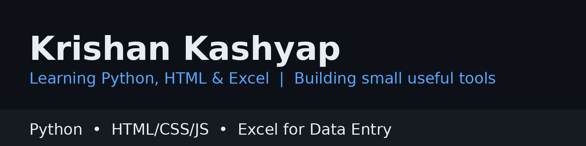

# Hi, I'm Krishan Kashyap 👋

**Learning in public — Python, HTML/CSS/JavaScript, and Excel — and building small, useful tools along the way.**

📍 India | 🎓 O Level (NIELIT)

## 🛠️ Skills

- **Excel for data entry work** — SUM, AVERAGE, COUNTIF, VLOOKUP, data cleaning, filters
- **Python** — working with files and CSV data (standard library)
- **Web basics** — HTML, CSS, and JavaScript

## 🎓 Qualification

- **O Level (NIELIT)** — completed

## 🚀 Projects

- **[deo-excel-practice](https://github.com/KrishanKashyap/deo-excel-practice)** — Excel formula quiz and data-entry typing practice, in the browser. No server, no installation, no data leaves your browser.
- **[csv-data-cleaner](https://github.com/KrishanKashyap/csv-data-cleaner)** — A small Python tool to clean a CSV file: trim spaces, drop empty rows, and remove duplicate rows, keeping the header and original order.

## 🌱 Right now

I'm improving these learning projects step by step — suggestions are welcome.
